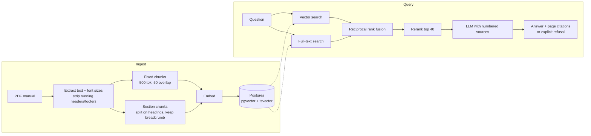

# Manuals RAG: measured technician Q&A over an industrial manual

[](https://github.com/Anqlem/rag-manuals/actions/workflows/ci.yml)

A retrieval-augmented generation system that answers field-technician questions from PDF equipment manuals. It cites the manual page for every claim and says "I don't know" when the manual doesn't cover the question. It runs **fully on-premises on CPU with open models**, or on cloud APIs (Anthropic, OpenAI, Gemini, Groq) by changing a few lines of config.

The point of the repo is the **evaluation**: two chunking strategies × three retrieval modes, scored on a page-labelled question set, plus an LLM-judged check of the answers, and a written analysis of what failed and why.

## Results at a glance

On the 1,028-page **Siemens S7-1200 system manual** with 34 questions (28 answerable, 6 unanswerable):

- **Retrieval:** section-aware chunking + hybrid search + cross-encoder reranking found a gold page in the top 5 for **89%** of questions (MRR 0.66), versus **75%** for a fixed-size, vector-only baseline. 5 questions fixed, 1 regressed. With 28 questions the confidence intervals overlap, so this is a trend, not a proven gain.
- **Refusals:** **6 of 6** unanswerable questions were refused, including a trap about OPC UA: newer S7-1200 firmware supports it, but this manual edition never mentions it, and the model did not fill the gap from its own knowledge.
- **Faithfulness:** 0.96 by LLM judge. Answer correctness is *not* reported as a headline number: the 3B judge proved unreliable (see [Failure analysis](#failure-analysis)).
- **Cost:** $0 per query. Everything runs locally: `bge-small` embeddings, a MiniLM cross-encoder and Llama 3.2 3B via Ollama, on a homelab VM's CPU.

## Retrieval results

28 answerable questions; a hit means a retrieved chunk overlaps a gold page. Full report: [`eval/results/retrieval.md`](eval/results/retrieval.md).

| Chunking | Retrieval | hit@1 | hit@3 | hit@5 (95% CI) | MRR@10 | page recall@5 | p50 latency |
|---|---|---|---|---|---|---|---|
| fixed | vector (baseline) | 0.46 | 0.68 | 0.75 (0.57–0.89) | 0.59 | 0.68 | 23 ms |
| fixed | hybrid | 0.39 | 0.54 | 0.61 (0.43–0.79) | 0.50 | 0.58 | 37 ms |
| fixed | hybrid + rerank | 0.43 | 0.71 | 0.75 (0.61–0.89) | 0.59 | 0.67 | 2.6 s |
| section | vector | 0.57 | 0.68 | 0.68 (0.50–0.82) | 0.63 | 0.61 | 25 ms |
| section | hybrid | 0.36 | 0.46 | 0.57 (0.39–0.75) | 0.45 | 0.55 | 39 ms |
| **section** | **hybrid + rerank** | 0.50 | 0.79 | **0.89 (0.79–1.00)** | **0.66** | **0.84** | 2.4 s |

## Answer results

Best retrieval config, Llama 3.2 3B answering and judging, 34 questions. Full report: [`eval/results/generation.md`](eval/results/generation.md).

| Metric | Value |
|---|---|
| Unanswerable questions correctly refused | **6 / 6** |
| Answerable questions answered (not refused) | 28 / 28 |
| Faithfulness: claims supported by the sources (LLM judge) | 0.96 |
| A citation lands on a gold page | 0.46 |
| LLM tokens per query | ~2,500 |
| Latency p50 / p95, end to end on CPU | 65 s / 86 s |
| Cost per query | $0 (local models) |

## How it works



| Piece | Choice | Why |
|---|---|---|
| Store | Postgres + pgvector (HNSW) | One database for vectors, keywords and metadata; no extra service |
| Embeddings | `BAAI/bge-small-en-v1.5` on CPU (or OpenAI) | Free and local; swappable by config |
| Keyword search | Postgres `tsvector`, codes like `8x3A` kept as phrases | Error codes, part numbers and parameters are exact strings that embeddings blur |
| Fusion | Reciprocal rank fusion (k = 60) | Cosine and `ts_rank` scores aren't comparable; RRF uses ranks only |
| Reranker | `ms-marco-MiniLM-L-6-v2` cross-encoder (or Cohere) | Scores question and passage together, which a bi-encoder can't |
| LLM | Llama 3.2 3B via Ollama, or any OpenAI-compatible API, or Claude | Runs on-prem; one client covers Ollama, Gemini, Groq and OpenAI |
| Prompt | Numbered `<source>` blocks, cite every claim, fixed refusal sentence | Citations map back to pages; refusals are machine-checkable; source text is treated as data, not instructions |

## Quickstart

Requirements: Docker with the Compose plugin, about 15 GB of free disk, 6–8 GB RAM.

```bash
# put your manuals in data/corpus/, then
./deploy.sh      # first run creates .env with the free, local setup; review it, then run again
```

`deploy.sh` builds the app, starts Postgres and Ollama, pulls the model and ingests `data/corpus/`. The UI is then at http://localhost:8000. Hosting on a homelab server (ports, SSH tunnel, disk space) is covered in [`docs/deployment.md`](docs/deployment.md).

No PDFs yet? `make demo` runs the whole pipeline on a small fictional manual with an offline stub embedder and LLM. It proves the plumbing only; its numbers mean nothing. It also **resets the database**, so don't run it on a deployment you've already ingested.

CLI:

```bash
docker compose exec app python -m rag ask "Red ERROR LED is blinking, what can cause it?" --mode hybrid_rerank
docker compose exec app python -m rag search "transfer card password" --strategy fixed --mode vector
docker compose exec app python -m eval.run_eval retrieval
docker compose exec app python -m eval.run_eval generation
```

## Corpus

| Document | Pages | Source |
|---|---|---|
| Siemens SIMATIC S7-1200 Programmable Controller, System Manual | 1,028 | [support.industry.siemens.com](https://support.industry.siemens.com/cs/attachments/91696622/s71200_system_manual_en-US_en-US.pdf) |

The manual is copyrighted, so it isn't committed (`data/corpus/*.pdf` is git-ignored). Download it to `data/corpus/` to reproduce the results.

**Scope:** a single manual. Choosing between several documents (e.g. two vendors with similar fault codes) is untested and is the first thing I'd add.

## Evaluation method

**Question set** ([`eval/questions.jsonl`](eval/questions.jsonl)): 34 questions, phrased the way a technician would ask rather than in the manual's words ("PLC drops into STOP every time I push an SD card in"). They were drafted with an LLM's help (marked `origin: "llm"`), and every gold page was checked against the extracted text. The set includes:

- **Symptom questions**, where the question doesn't name the cause
- **Model-specific questions** over near-identical spec tables (CPU 1211C–1217C)
- **Multi-page answers**, e.g. a temperature limit from the spec table plus a mounting note
- **Answers stored in tables:** error codes, Modbus limits
- **6 unanswerable questions:** warranty, price, MTBF, MQTT/AWS, Python, and the OPC UA trap

**Gold labels are pages, not chunks**, so the same labels work for every chunking strategy. A gold label is *every page that contains the answer*.

**Retrieval metrics:** hit@1/3/5, MRR@10 and page recall@5, with 95% bootstrap intervals and a paired list of questions fixed or broken relative to the baseline.

**Answer metrics:** refusal rate on unanswerable questions, LLM-judged faithfulness and correctness, whether a citation lands on a gold page, tokens, cost and latency.

## Failure analysis

**Retrieval**

1. **Model confusion (2 of the 3 remaining misses).** The CPU 1211C–1217C spec tables are near-identical, and the small embedding model doesn't separate "1214C" from "1217C". s7_10 retrieved the 1217C table; s7_21 retrieved the 1215C page carrying the same relay note. *Candidate fix:* filter by CPU model, taken from the section path, before ranking.
2. **Vocabulary gap (s7_13).** "The clock was wrong after a three-week shutdown" shares no terms with "a super-capacitor keeps the time-of-day clock running for typically 20 days". *Candidate fix:* LLM query rewriting before retrieval.
3. **Keyword search hurts without reranking.** OR-ed full-text terms match hundreds of chunks on generic words (PLC, CPU), and reciprocal rank fusion weights that noise equally with the vector ranking. hit@5 drops from 0.68 to 0.57 for section chunks. The reranker more than recovers it (0.89), at about 2.4 s per query on CPU. *Next experiment:* weighted fusion and length-normalised `ts_rank`.
4. **Labelling lesson.** The first run reported two false misses: the 24 V supply range is printed on every CPU's spec page, not only the general one, and "install in a cabinet" answers the dust question as well as the IP20 table does. Gold labels were redefined as *every page that contains the answer* and the rule was applied to all questions. The fix raised every configuration's numbers, so the comparison stayed fair.

**Answers**

5. **The 3B judge is unreliable.** Of the 7 answers it flagged, reading them against the manual showed that 5 were correct (e.g. it read a warning *against* parallel power supplies as permission). One was most likely correct, and one was a real error. The other 21 answers weren't reviewed by hand, so the judge's correctness score (0.67) isn't trustworthy and isn't reported as a result. *Fix:* a stronger judge model, validated against a hand-graded sample.
6. **Citations miss the gold page more often than retrieval does.** A gold page is in the top 5 for 89% of questions, but the 3B model cites one in only 46% of answers, often citing a neighbouring source.
7. **Tables.** s7_18 answered with a value from the wrong row of the 1217C spec table ("L+ minus 4 VDC" instead of 20.4–28.8 VDC). Row-by-row text extraction breaks the link between a table's labels and its values.
8. **Latency.** 65–85 s per answer on CPU with ~2,500 tokens of context. This setup suits evaluation and offline use; interactive use needs a GPU, a smaller context (top 3 chunks) or a hosted model.

## Limitations

- A single document; cross-document retrieval is untested.
- 34 questions, so differences of a few points are within noise.
- Answer correctness was not hand-graded in full.
- The web UI has no authentication. Keep it on localhost, a LAN or a VPN; never expose it to the internet as is.

## Next steps

- Model-aware metadata filtering for spec tables
- Weighted RRF and normalised keyword ranking (failure 3)
- Query rewriting for symptom-style questions (failure 2)
- Table-aware extraction (e.g. Docling) compared on table questions
- A stronger judge, checked against a hand-graded sample
- A second manual from a different vendor
- Tracing (Langfuse/OpenTelemetry), and an eval regression run in CI

## Repo layout

```
rag/              core package: extract, chunking, embeddings, retrieval, rerank, llm, answer, api
  static/         one-page web UI
eval/             questions, metrics, run_eval, labelling + drafting helpers
  results/        the reports quoted above
docs/             deployment guide
scripts/          sample-manual generator (used by tests and `make demo`)
tests/            unit + integration tests (offline, against real Postgres)
.github/workflows CI: ruff, pytest against pgvector, eval smoke run, Docker build
```

## License

MIT, see [LICENSE](LICENSE). The manual itself is © Siemens AG and isn't part of this repository.
